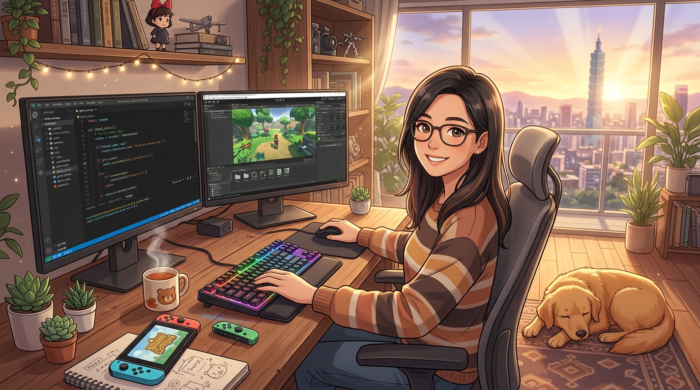

  

# Hi there, I'm Sofia (林敏潔) 👋

Full-stack & distributed systems engineer based in **Taipei, Taiwan** 🇹🇼. 

I enjoy building performant, reliable services, exploring graphics programming and low-level optimization, and creating intuitive digital experiences. When I'm not writing code or experimenting with game engines, you can usually find me playing indie games or hiking with my golden retriever, **Mochi**.

---

### 💻 What I'm Working On
- ⚡ **High-Throughput Services**: Exploring memory-efficient architectures, concurrency primitives, and asynchronous runtimes.
- 🎮 **Game Dev & Shaders**: Experimenting with compute shaders, Godot, and low-level rendering pipelines in Rust/C++.
- 🔍 **Open Source Exploration**: Digging into database internals, vector search algorithms, and compiler tooling.

---

### 🛠️ Languages & Technologies
- **Languages**: Rust, TypeScript, Python, Go, C++, SQL
- **Frameworks & Runtimes**: Tokio, Axum, Node.js, Next.js, React, FastAPI
- **Data & Infrastructure**: PostgreSQL, Redis, ClickHouse, Docker, Linux, Git
- **Hobbies & Creative**: Godot Engine, HLSL/GLSL, Blender

---

### 🐕 Beyond the Terminal
- 🐾 Long weekend walks and mountain trails around Yangmingshan with my dog.
- 🎮 Cozy indie adventures, RPGs, and retro platformers.
- 🍵 Brewing high-mountain oolong tea and single-origin pour-overs.

---
